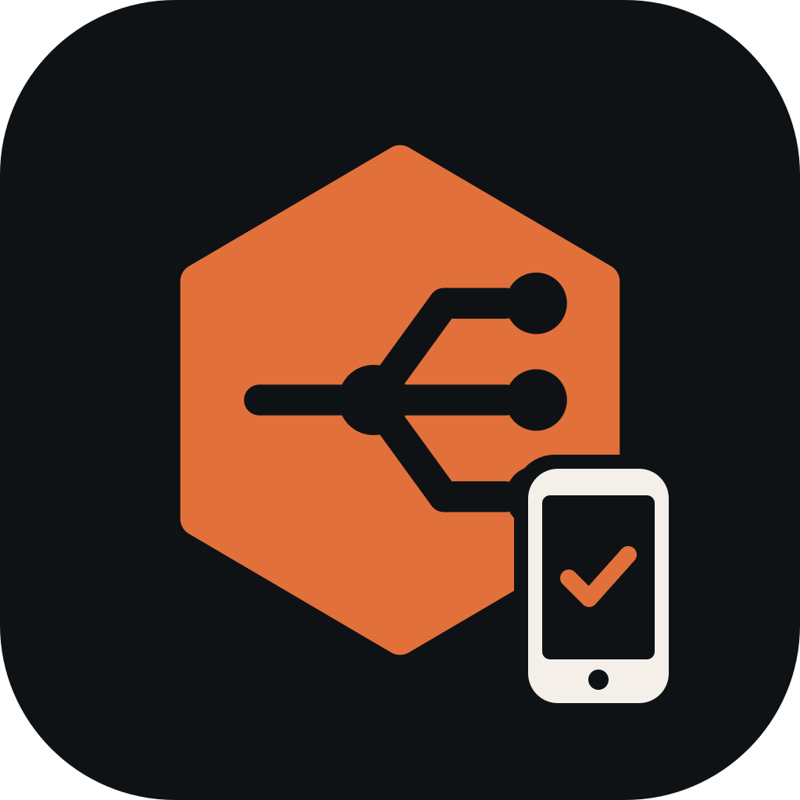

# RustProxy Mobile Pass



Reach the sites you've locked to your own networks, from your phone, anywhere.

Primary home: https://gitlab.jpps.us/jpps/rustproxy-mobile-pass (issues, merge requests and releases live there). The GitHub copy at https://github.com/4jpps/rustproxy-mobile-pass is a read-only mirror, updated automatically from GitLab.

[RustProxy](https://gitlab.jpps.us/jpps/rust-proxy) can restrict a site to an **IP allow list**: only
your home or office networks get in. That shuts you out too, the moment your phone is on cellular or
hotel Wi-Fi. Mobile Pass is the way around it for your own phone, without opening the site to
everyone or putting a login page in front of an app that can't use one.

## How it works

1. In RustProxy, turn on **Network > Mobile passes**, and for the IP allow list you want to reach,
   pick its **Mobile pass logins** (a RustProxy login list). See RustProxy's
   [access control docs](https://gitlab.jpps.us/jpps/rust-proxy/-/blob/main/docs/access-control.md#mobile-passes-getting-past-ip-allow-lists-while-mobile).
2. In the app, sign in with the address of any site on your RustProxy and a username and password
   from that login list.
3. Flip the switch on. RustProxy now lets this phone's **current** IP through every allow list that
   accepts that login.

While the switch is on, the app checks in every 4 minutes and within 30 seconds of the phone
changing networks:

- **Only the current IP.** Each check-in replaces the phone's previous IP, so the network you just
  left is no longer let in.
- **Short passes.** A pass lasts 10 minutes after the last check-in, so a phone that goes offline drops
  out on its own.
- **Off means off.** Switching off signs the phone out and the pass ends immediately.
- **Nothing remembered.** Neither the app nor RustProxy keeps a list of past IPs. The app stores only
  the server address, username, device name and password, in the phone's secure storage (Android
  Keystore / iOS Keychain), and only ever sends them over HTTPS to your RustProxy.

A pass trusts the address: anyone else behind the same public IP (cellular carrier NAT, hotel Wi-Fi)
is let through the allow list while it is live. Use it for sites that still ask for their own
password, not as their only protection.

## Platforms

One Flutter codebase:

| Platform | Background check-ins |
|---|---|
| Android | Yes: a foreground service with a small "Mobile pass on" notification, resumed after a reboot. Allow it to ignore battery optimization when asked. |
| iOS | Only while the app is open: iOS doesn't let apps keep running in the background. The pass then runs out on its own after 10 minutes. |
| Windows, macOS, Linux | While the app is running. |

## Building

Needs Flutter (stable) and, for Android, the Android SDK.

```sh
flutter test
flutter build apk --release        # Android
flutter build ios                   # on a Mac with Xcode
flutter build windows|macos|linux   # desktop, on that OS
```

Android release builds are signed with the key in `android/key.properties` (not committed). Without
it, a release build is signed with the debug key. Updates to an installed app must be signed with the
same key as the version already installed.

## The check-in, for other clients

`POST https://<any site on the RustProxy>/.rust-proxy/mobile-pass` with
`{"username": "...", "password": "...", "device": "my phone"}` grants the pass:
`{"ok": true, "ip": "<the IP RustProxy saw>", "expires_in": 600}`. `DELETE` with the same body ends it.
401 means a wrong username or password, 404 that mobile passes are off, and 429 too many wrong
passwords from that network.

## License

AGPL-3.0, like RustProxy. Made by Jeff Parrish PC Services LLC.
